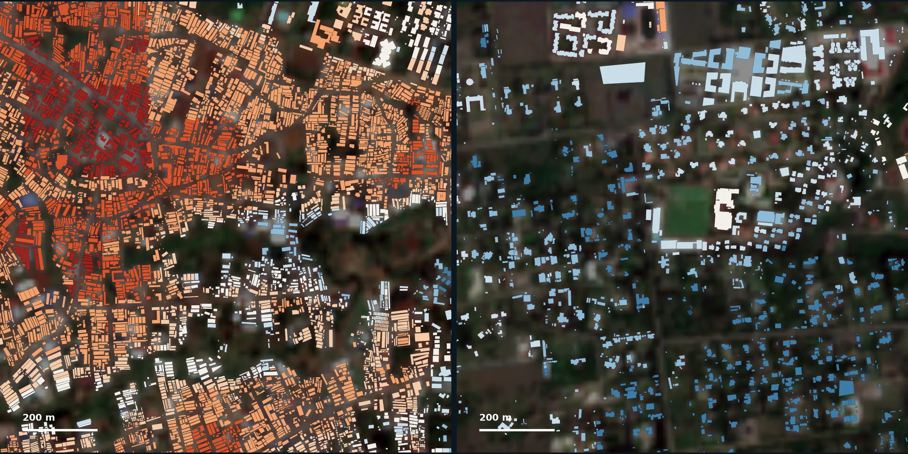

<a name="readme-top"></a>

<!-- Structure after the Best-README-Template (https://github.com/othneildrew/Best-README-Template), via https://github.com/Kinjuriu/Best-README-Template -->

<br />
<div align="center">
  <a href="https://kinjuriu.github.io/joto-mjini-nairobi/">
    
  </a>

  <h3 align="center">Joto Mjini Nairobi</h3>

  <p align="center">
    Mapping urban heat and cooling inequality across Nairobi
    <br />
    <a href="https://kinjuriu.github.io/joto-mjini-nairobi/"><strong>Read the story »</strong></a>
    <br />
    <br />
    <a href="https://kinjuriu.github.io/joto-mjini-nairobi/#explore">Find your ward</a>
    ·
    <a href="https://kinjuriu.github.io/joto-mjini-nairobi/methods.html">Methods, data and resources</a>
    ·
    <a href="https://github.com/Kinjuriu/joto-mjini-nairobi/issues">Report a problem</a>
  </p>
</div>

<details>
  <summary>Table of Contents</summary>
  <ol>
    <li>
      <a href="#about-the-project">About The Project</a>
      <ul>
        <li><a href="#built-with">Built With</a></li>
        <li><a href="#data">Data</a></li>
      </ul>
    </li>
    <li>
      <a href="#getting-started">Getting Started</a>
      <ul>
        <li><a href="#prerequisites">Prerequisites</a></li>
        <li><a href="#installation">Installation</a></li>
      </ul>
    </li>
    <li><a href="#usage">Usage</a></li>
    <li><a href="#repository-layout">Repository Layout</a></li>
    <li><a href="#roadmap">Roadmap</a></li>
    <li><a href="#contributing">Contributing</a></li>
    <li><a href="#license">License</a></li>
    <li><a href="#contact">Contact</a></li>
    <li><a href="#acknowledgments">Acknowledgments</a></li>
  </ol>
</details>


## About The Project

Joto Mjini Nairobi ("heat in the city" in Swahili) is an open data story about where heat falls in Nairobi and who lives and learns on the hottest ground. It uses the Landsat 8 and 9 satellites to measure land surface temperature, meaning how hot the ground, roofs and roads are, on clear January to March mornings from 2023 to 2026, and it sets that heat beside where people live, where the city's schools stand and where its trees grow.

The story finds that about seven in ten of Nairobi's school-age children, roughly one million children aged 4 to 17, live on the hotter half of the city, and that the land around the schools there has very few trees: within 200 m of a school on the hotter half, a median of 2.5 % of the ground is under trees, against 21.9 % around schools on the cooler half. The five hottest wards where people live held about 187,000 people on 11.3 km² at the 2019 census, while the five coolest held about 157,000 on 143.6 km². The story ends with a map where anyone can look up their own ward and see which side of Nairobi it is on.

The numbers are estimates with stated limits: satellites measure the ground, not the air people feel or the inside of classrooms; population comes from modelled WorldPop estimates and the 2019 census; and the school map is a broad map of school sites, without pupil numbers. Every number on the site traces back to a script and a source, listed in [`analysis/FINDINGS.md`](analysis/FINDINGS.md) and on the [methods page](https://kinjuriu.github.io/joto-mjini-nairobi/methods.html).

The project was prepared for the workshop "Land, Food and Heat Resilience in Africa's Arid Regions" in Nairobi on 26 November 2026, hosted by the Earthna Center for a Sustainable Future and the Children's Investment Fund Foundation. The hosts did not commission or review it.

<p align="right">(<a href="#readme-top">back to top</a>)</p>

### Built With

* Python 3.12 with [uv](https://docs.astral.sh/uv/): rasterio, GeoPandas, NumPy, pandas, xarray and odc-stac for the data pipeline and analysis
* [Vite](https://vite.dev/) for the site, with [Mapbox GL JS](https://docs.mapbox.com/mapbox-gl-js/) for the maps and [D3](https://d3js.org/) for hand-built charts
* GitHub Actions and GitHub Pages for publishing

### Data

* Landsat 8 and 9 Collection 2 Level-2 surface temperature (USGS), via Microsoft Planetary Computer
* ESA WorldCover 2021 land and tree cover; Sentinel-2 imagery (Copernicus); EOxCloudless 2025 imagery
* WorldPop 2025 population; Kenya National Bureau of Statistics 2019 census, Volumes II to IV ([extracted to CSV here](https://github.com/Kinjuriu/kenya-2019-census-csv))
* Schools: Kenya Ministry of Education list via the World Bank, and OpenStreetMap
* Overture Maps building footprints; GHSL built-up area; IEBC ward boundaries via the American Red Cross and HDX
* Copernicus hourly land surface temperature; Open-Meteo (ERA5) air temperature

Licences and citations for every dataset are in [`data/SOURCES.md`](data/SOURCES.md).

<p align="right">(<a href="#readme-top">back to top</a>)</p>


## Getting Started

### Prerequisites

* Python 3.12 and [uv](https://docs.astral.sh/uv/getting-started/installation/)
* Node.js 22 and npm
* A free [Mapbox](https://account.mapbox.com/) public access token, to draw the maps

### Installation

1. Clone the repository
   ```sh
   git clone https://github.com/Kinjuriu/joto-mjini-nairobi.git
   cd joto-mjini-nairobi
   ```
2. Install the Python environment
   ```sh
   uv sync
   ```
3. Install the site
   ```sh
   cd site
   npm ci
   ```
4. Add your Mapbox token in `site/.env.local` (this file is ignored by git)
   ```sh
   VITE_MAPBOX_TOKEN=your_public_token
   ```
5. Run the site, then open the address the terminal shows
   ```sh
   npm run dev
   ```

<p align="right">(<a href="#readme-top">back to top</a>)</p>


## Usage

* **Read the story** at <https://kinjuriu.github.io/joto-mjini-nairobi/>, or run it locally as above.
* **Look up a ward** in "Explore the map": its surface temperature, people, school-age children, schools and tree cover, and which half of the city it is on.
* **Download the data** (ward table, schools, people and children by heat, charts) from the [methods page](https://kinjuriu.github.io/joto-mjini-nairobi/methods.html). The ward and school files open in QGIS or any web map.
* **Rebuild the numbers.** The pipeline is in `src/pipeline` (numbered steps `s1` to `s10`), the analysis in `src/analysis` and the web tiles in `src/web/tiles.py`; each script runs with `uv run python -m <module>`, and its docstring says what it reads and writes.
* **Publish.** Every push to `main` builds the site and publishes it on GitHub Pages through `.github/workflows/deploy-pages.yml`, which reads the Mapbox token from the `MAPBOX_TOKEN` repository secret.

<p align="right">(<a href="#readme-top">back to top</a>)</p>


## Repository Layout

| Folder or file | What it holds |
|---|---|
| `site/` | The story site: `index.html`, `methods.html`, `src/` (maps, charts, explorer), `public/` (data, tiles, figures, animations) |
| `src/pipeline/` | Downloading and preparing the satellite, land cover, population, buildings and school data |
| `src/analysis/` | The questions and every number on the site |
| `analysis/` | Results (`results.json`, `results_extra.json`), tables and `FINDINGS.md` |
| `data/SOURCES.md` | Every dataset, its licence and citation |
| `DECISIONS.md` | Each method choice, dated, with the reason for it |
| `DESIGN_RULES.md` | The design rules the site follows |

<p align="right">(<a href="#readme-top">back to top</a>)</p>


## Roadmap

- [x] Heat divide maps, wards and the explorer
- [x] Schools, school-age children and trees around schools
- [x] Live site on GitHub Pages
- [ ] Workshop presentation, 26 November 2026
- [ ] A longer article on the heat divide and Nairobi's children
- [ ] Ward populations scaled to 2019 census locations, to correct WorldPop in Kibra and Kangemi
- [ ] Pupil numbers for each school from the Ministry of Education's register
- [ ] Classroom air temperature measurements, and afternoon and night-time heat
- [ ] Rainfall, flooding and El Niño

See the [open issues](https://github.com/Kinjuriu/joto-mjini-nairobi/issues) for proposed changes and known problems.

<p align="right">(<a href="#readme-top">back to top</a>)</p>


## Contributing

Corrections and suggestions are welcome, especially from people who know Nairobi's wards and schools. Open an issue describing the problem or the idea; for a change to the code or the data, fork the repository, create a branch, commit your change and open a pull request.

<p align="right">(<a href="#readme-top">back to top</a>)</p>


## License

Copyright (c) 2026 Stephane Ngugi. All rights reserved.

* **Code:** proprietary; no reuse without written permission (see [`LICENSE`](LICENSE)). Versions published before 26 November 2026 were released under the MIT License, and copies of those versions keep it.
* **Storyboard text, maps, charts and design:** [CC BY-NC 4.0](LICENSE-CONTENT.md); credit Stephane Ngugi, Joto Mjini Nairobi, and no commercial use without permission.
* **Data:** each dataset keeps its own licence, listed in [`data/SOURCES.md`](data/SOURCES.md). Databases derived from OpenStreetMap and Overture Maps are under the ODbL, and images with EOxCloudless imagery are CC BY-NC-SA 4.0.

### How to cite

> Ngugi, S. (2026). *Joto Mjini Nairobi: Nairobi's heat divide and the children who live and learn on its hot side.* https://kinjuriu.github.io/joto-mjini-nairobi/

GitHub's "Cite this repository" button uses [`CITATION.cff`](CITATION.cff).


## Contact

Stephane Ngugi, Senior Data Analyst & Researcher, Independent Researcher

[LinkedIn](https://www.linkedin.com/in/stephane-njoki/) · [GitHub](https://github.com/Kinjuriu)

Project: <https://github.com/Kinjuriu/joto-mjini-nairobi>

<p align="right">(<a href="#readme-top">back to top</a>)</p>


## Acknowledgments

* The structure of the story follows NASA Earthdata's ["Fanning the Flames"](https://earthdata.nasa.gov/dashboard/stories/la-fires) story on the 2025 Los Angeles wildfires
* The data providers listed above, whose open data made this possible
* [Best-README-Template](https://github.com/othneildrew/Best-README-Template) for the layout of this README

<p align="right">(<a href="#readme-top">back to top</a>)</p>
